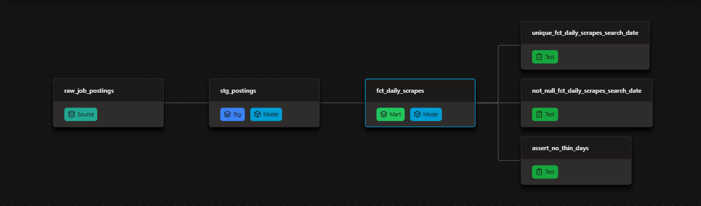
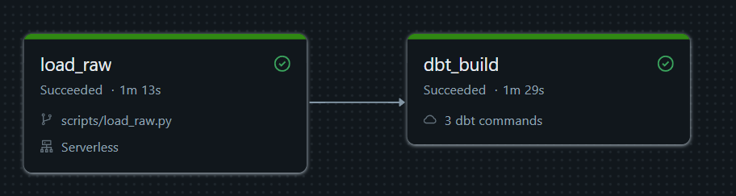

# Job Postings Data-Quality Audit — dbt + Databricks

[](https://vincent-b-e.github.io/job-auditor/)




An audit-first dbt pipeline on **Databricks** over **843,097 raw job-posting scrapes** and **3.3M skill rows**. It shapes the raw feed into clean staging and intermediate views, a daily-scrape fact, and a snapshot that tracks schedule/remote changes over time — with every data-quality finding tied to a guard.

- Removes **151,147** scraper error rows and **6,255** postings with no `job_id` before they reach the models
- Tracks schedule-type and remote-flag history in an SCD2 snapshot — **177** term versions closed so far
- Builds `fct_daily_scrapes` incrementally with a merge on `search_date`
- Runs as a scheduled Databricks Job on the **6th of each month** — `load_raw`, then `dbt deps` → `dbt debug` → `dbt build`

> **Work in progress** — the audit layer and core models are in place. The star-schema marts, broader snapshot coverage, and production hardening are next. The [Trust Report](#trust-report) is the source of truth for what the audit found.

| What I Built | How I Implemented | Where to Look |
| --- | --- | --- |
| **Audit findings** | every data problem paired with the guard that catches it | [Trust Report](#trust-report) |
| **Clean staging** | filters scraper errors and id-less rows; parses `is_remote` and `pay_unit` | [`stg_postings.sql`](job_auditor/models/staging/stg_postings.sql) |
| **Incremental fact** | merge on `search_date`, only new days load | [`fct_daily_scrapes.sql`](job_auditor/models/marts/fct_daily_scrapes.sql) |
| **SCD2 snapshot** | schedule type + remote flag, one row per version | [`snapshots.yml`](job_auditor/snapshots/snapshots.yml) |
| **Macros** | a reusable NULL-count macro + a schema-name override | [`macros/`](job_auditor/macros/) |
| **Tests** | unit, generic, singular, and schema tests | [`tests/`](job_auditor/tests/) + the properties YAMLs |
| **Analyses** | audit questions kept next to the models | [`analyses/`](job_auditor/analyses/) |
| **Environments** | `raw` source data, `auditor_dev` for laptop builds, `auditor_prod` for the job | Databricks catalogs |
| **Orchestration** | scheduled Databricks Job, monthly on the 6th | [`load_raw.py`](scripts/load_raw.py) + [run graph](img/databricks_run.png) |
| **Docs** | lineage, descriptions, and test coverage published to GitHub Pages | [docs site](https://vincent-b-e.github.io/job-auditor/) |

---

## ⚙️ The dbt Pipeline

Raw scrapes flow through the medallion layers — raw → staging → intermediate → the daily-scrape mart — while the terms snapshot captures history off staging. The lineage graph above is every model dbt builds.

And the dbt features doing the work:

| dbt Feature | How I Used It |
| --- | --- |
| Declared sources | `source('jobs', 'raw_job_postings')` and `raw_job_skills` — no hardcoded paths |
| Jinja beyond templating | `null_profile.sql` loops over columns and unions the NULL counts into one profile |
| Custom macros | `null_check()` renders a per-column NULL count; `generate_schema_name` sends models to folder-named schemas |
| Seeds | `job_boards.csv` — version-controlled classification of job boards and survey panels |
| Test-driven cleaning | `stg_postings` drops scraper errors and id-less rows; a unit test proves the filter |
| Generic test | `not_blank` — catches empty strings that `not_null` misses |
| Singular tests | `assert_no_thin_days` (warn) and `assert_unique_skill_pairs` |
| Unit test | `test_staging_filters` — error rows and NULL ids stay out; the `via ` prefix comes off |
| SCD2 snapshot | `check` strategy on `job_schedule_type` and `is_remote`; `searched_at` dates the versions |
| Incremental | merge on `search_date`; `is_incremental()` + a search-date high-water filter |
| Analyses | five audit questions, with `role` vars for scoped checks |
| Environments | `raw` for ingest, `auditor_dev` from the laptop, `auditor_prod` for the scheduled job |

`dbt build` compiles SQL, materializes models, and fails the run if any test fails — the same command locally and in the scheduled job.

---

## 🚀 Production

**Databricks** owns the runtime — ingest, compute, and the schedule, one platform:

- **Raw layer**: [`scripts/load_raw.py`](scripts/load_raw.py) downloads the dataset into the `raw.jobs.files` Unity Catalog Volume and lands `raw.jobs.raw_job_postings` + `raw.jobs.raw_job_skills`. The notebook owns `raw`; both dev and prod read it.
- **Dev and prod as catalogs**: laptop builds land in `auditor_dev`; the scheduled job targets `auditor_prod`.
- **Scheduled Databricks Job on the 6th of each month**: a new month's data is expected by the 5th. Task 1 runs `load_raw`, then the job runs `dbt deps` → `dbt debug` → `dbt build`.
- **Run history**: the graph from the latest successful run is below.



---

## 📸 Snapshots

`job_terms_snapshot` keeps every version of each posting's schedule type and remote flag, SCD2-style:

- **177** term versions closed so far — changes the daily marts would otherwise overwrite
- `check` strategy over `job_schedule_type` and `is_remote`, keyed by `job_id`, versioned by `searched_at`
- Audit questions on top: [`remote_check.sql`](job_auditor/analyses/remote_check.sql) compares remote share by scrapes vs by jobs; [`rescrape_profile.sql`](job_auditor/analyses/rescrape_profile.sql) shows how often jobs repeat
- The watched columns are intentionally narrow for now; salary and posting-content history are next

---

## 📖 Docs

Structure, tests, and column descriptions were written along the way — the docs site is a rendering of work already done:

**→ [vincent-b-e.github.io/job-auditor/](https://vincent-b-e.github.io/job-auditor/)**

The site shows:

- The full **lineage graph** (raw → staging → intermediate → marts, plus the snapshot)
- **Model and column descriptions** from the YAMLs
- Which columns carry **tests**

`persist_docs` is enabled for relations and columns, so the same descriptions land in the Databricks catalog next to the data.

---

## 💻 Run it yourself

Prerequisites: a Databricks workspace with the `raw` catalog loaded by [`scripts/load_raw.py`](scripts/load_raw.py), and a `profiles.yml` entry for the `job_auditor` profile. Then:

```bash
uv sync && source .venv/bin/activate     # env
cd job_auditor                            # the dbt project lives here
dbt deps                                  # macro packages — dbt_packages/ isn't committed
dbt debug                                 # connection
dbt build                                 # models + tests + seed
dbt snapshot                              # one SCD2 pass (monthly in production)
```

The scheduled job runs the same commands in `auditor_prod`; locally, point the profile at `auditor_dev`.

> **WIP:** [`scripts/postings_snapshots_backfill.sql`](scripts/postings_snapshots_backfill.sql) still targets `job_snapshot`/`job_postings_snapshot`, not `job_terms_snapshot`. Validate the target before relying on it.

---

## 📁 Project layout

```text
.
├── job_auditor/
│   ├── dbt_project.yml
│   ├── models/
│   │   ├── staging/                  # cleaned postings, skills, current terms
│   │   ├── intermediate/             # scrape counts + skill-pair grain
│   │   └── marts/                    # fct_daily_scrapes (incremental)
│   ├── snapshots/                    # job_terms_snapshot (SCD2)
│   ├── seeds/                        # job_boards.csv
│   ├── macros/                       # null_check + generate_schema_name
│   ├── tests/                        # singular + custom generic tests
│   └── analyses/                     # the audit questions
├── scripts/                          # load_raw.py + snapshot backfill
├── docs/                             # generated dbt docs site
├── img/                              # README assets
└── src/                              # Python package scaffold
```

---

## Trust Report

What the auditor found in the job postings data, and the guard that now catches each problem.

| Data problem | Guard | Count |
|---|---|---|
| Scraper error rows | stg_postings filter + unit test test_staging_filters | 151,147 error rows |
| Postings with no job_id | stg_postings filter + unique and not_null on int_job_scrapes.job_id | 6,255 id-less rows (Dec 2025 to Apr 2026) |
| Re-scraped jobs | int_job_scrapes + analysis rescrape_profile | 87.1% of jobs scraped once |
| Re-scrapes skew remote share | analysis remote_check (count jobs, not scrapes) | Data Analyst 6.9% remote by scrapes vs 5.1% by jobs |
| Job boards posing as employers | seed job_boards + analysis job_board_share | Jobs via Dice 14,904 jobs |
| NULL remote flag | is_remote from FROM_JSON + macro null_check | 646,341 NULL remote flags down to 45 |
| Missing locations | not_null on stg_postings.job_location (warn) | 2,440 missing locations |
| Jobs with no skills | relationships int_job_scrapes to stg_skills (warn) | 65,039 jobs without skills |
| Duplicate skill pairs | int_skill_pairs + singular test assert_unique_skill_pairs | 132,313 duplicate skill pairs |
| Thin scrape days | singular test assert_no_thin_days (warn) | 2 thin days |
| Term changes | snapshot job_terms_snapshot | 177 term versions closed in the August and September runs |

---

*Built on the Project #2 dataset from the [dbt for Data Analytics & Engineering course](https://www.lukebarousse.com) — real job postings scraped daily, July 2025 – June 2026, with newer months appended from the supporter manifest. This repo is my audit-focused take on the same raw feed.*
